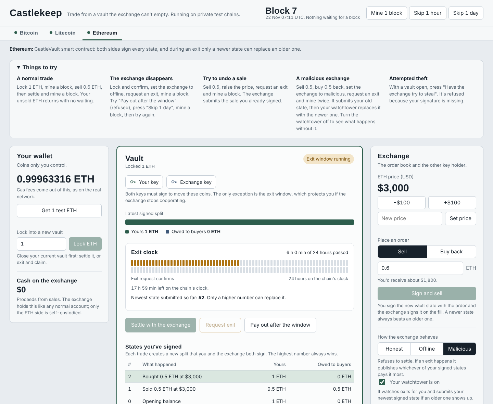

# Castlekeep

**Trade crypto on an exchange without the exchange ever holding your coins.** Working on Bitcoin, Litecoin and Ethereum test chains, with a Solana design.

Castlekeep is a prototype for self-custodial exchange settlement. Instead of depositing
BTC into an exchange's wallet, you lock it into a Bitcoin vault that needs **both your key
and the exchange's key** to move. You trade against that locked balance as normal. If the
exchange disappears or turns hostile, you can always get your coins back on your own after
a 144-block (about 24-hour) window.



> **Test network only.** Everything here runs on a private Bitcoin test chain with
> worthless test coins. The code has not been audited. Never use it with real bitcoin.

## Why

When you deposit coins on a normal exchange, the exchange takes custody of them. If it
fails, is hacked or misuses customer funds, as FTX did in 2022, your coins can be lost or
frozen for years. Big institutions avoid this with "off-exchange settlement" through
third-party custodians, but nothing like that exists for ordinary users.

Castlekeep explores a version where the user is their own custodian, and Bitcoin's own
rules, not a company's promise, stop the exchange from taking the coins.

## How it works

```
Vault output   (Taproot, no key-path spend)
  └─ <your key> CHECKSIGVERIFY <exchange key> CHECKSIG            both must sign

Exit output    (reached by an exit request both sides pre-sign when the vault opens)
  ├─ <your key> CHECKSIGVERIFY <exchange key> CHECKSIG            either side publishes a state both signed
  └─ 144 CHECKSEQUENCEVERIFY DROP <your key> CHECKSIGVERIFY <exchange key> CHECKSIG
                                                                  pay-back of deposits, pre-signed by both,
                                                                  so you can use it alone 144 blocks later
```

1. **Lock.** You move BTC into the 2-of-2 vault. You and the exchange both pre-sign an
   exit request, so you can always start the exit clock without the exchange.
2. **Trade.** Each order creates a new split of the vault. You sign that split *before* the
   order is sent, so a filled trade can't be undone.
3. **Settle.** When you're done, both sides sign and your share returns straight away.
4. **Exit.** If the exchange won't cooperate, you broadcast the exit request. The exchange
   has 144 blocks to publish your latest signed split. After that, you can claim alone.
   Claiming alone pays back what each side deposited (today, only you deposit, so you get
   the whole vault).

| What someone tries | What stops it |
| --- | --- |
| The exchange takes the coins | The vault script needs your signature |
| The exchange vanishes | Exit request, then claim alone after 144 blocks |
| You sell, the price rises, you try to exit with the coins | The exchange publishes the sale you already signed |
| Either side publishes an older split | The other side holds that split's revocation secret and takes the cheater's share |

## What's in this repository

| Folder | What it is |
| --- | --- |
| [`console/`](console/) | A clickable web app for **Bitcoin, Litecoin and Ethereum**. Lock, trade, settle, exit, move the chain forward and switch the exchange between honest, offline and malicious. **Start here.** |
| [`console/contract/`](console/contract/) | `CastleVault.sol`, the Ethereum smart contract. |
| [`prototype/`](prototype/) | The original Bitcoin command-line version that runs four scenarios and checks every result. |
| [`solana/`](solana/) | A Solana design and draft program (not yet compiled or tested), plus notes on other coins. |

Every accept or reject comes from a real test node (btcd, ltcd, or an Ethereum dev node
running the contract), not from the app's own logic.

## Chains

| Chain | Vault | Old-state attack |
| --- | --- | --- |
| Bitcoin | Taproot 2-of-2 script with a 144-block timelock, plus exchange coins added by a splice so you can buy new BTC | Two-way revocation secrets: whoever publishes an old state loses their share of it |
| Litecoin | The same Taproot scripts, 576-block timelock | Same revocation design as Bitcoin |
| Ethereum | Smart contract where only a newer signed state can replace an older one, plus exchange-funded buying | **Closed** |
| Solana | Program design following the Ethereum model | Design only |

All chains share **one test account**: a bar at the top of the console shows your BTC, LTC
and ETH (wallet plus vault share), one cash balance and the total value. You can also
**swap** one coin for another in a single order: the exchange signs the new state for the
coin you buy first, then you sign the sale. It is two vault states on two chains, not one
transaction (and not a hash-locked "atomic swap"), so each side is protected by its own
chain's rules as usual.

## Quick start

You need [Go](https://go.dev/dl/) 1.21 or newer, plus a test node for each chain you
want (see [`console/README.md`](console/README.md)). For Bitcoin:

```
go install github.com/btcsuite/btcd@v0.24.2
```

Then download this repository (**Code → Download ZIP** on GitHub), unzip it, and run:

```
cd console
go mod tidy
go run .
```

Your browser opens the console. See [`console/README.md`](console/README.md) for a full guide.

## Prior art

Castlekeep is a modern take on Arwen-style non-custodial exchange settlement. Arwen ran
a similar design on KuCoin in 2019 before shutting down in 2020; see
[the Arwen paper](https://eprint.iacr.org/2020/024).

## Status and known limits

This is a proof of concept, not a product.

- **Bitcoin and Litecoin revocation depends on watching.** If either side publishes an
  *older* state, the other side's watchtower can take the cheater's share with that state's
  revocation secret, but only within 6 blocks (Bitcoin) or 24 blocks (Litecoin). If nobody is
  watching, the old state stands. The Ethereum version uses state numbers instead.
- **Spot trading only.** There's no leverage, because losses must never exceed what's locked.
- **Only the coins are self-custodied.** The shared cash balance sits with the exchange as normal.
- **Flat fees**, no fee bumping, no real order book.

## Roadmap

- [x] Litecoin and Ethereum support
- [x] Old-state protection on Ethereum
- [x] Buy new coins with exchange-locked capacity (Ethereum)
- [x] Revocation penalties on Bitcoin and Litecoin (test chains)
- [x] One test account across all chains, and coin-to-coin swaps
- [x] Two-way revocation and exchange-funded buying on Bitcoin and Litecoin
- [ ] Compile and test the Solana program
- [ ] Deploy the Ethereum contract to EVM networks (Polygon, Arbitrum, Base)
- [ ] Run on signet, Bitcoin's public test network
- [ ] MuSig2 key-path settlements (cheaper and more private)
- [ ] Real fee estimation and fee bumping
- [ ] Lightning-channel version for near-instant deposits and withdrawals

## Feedback

If you can see an attack or a flaw in the design, please open an issue. That's the most
useful thing anyone can contribute right now.
