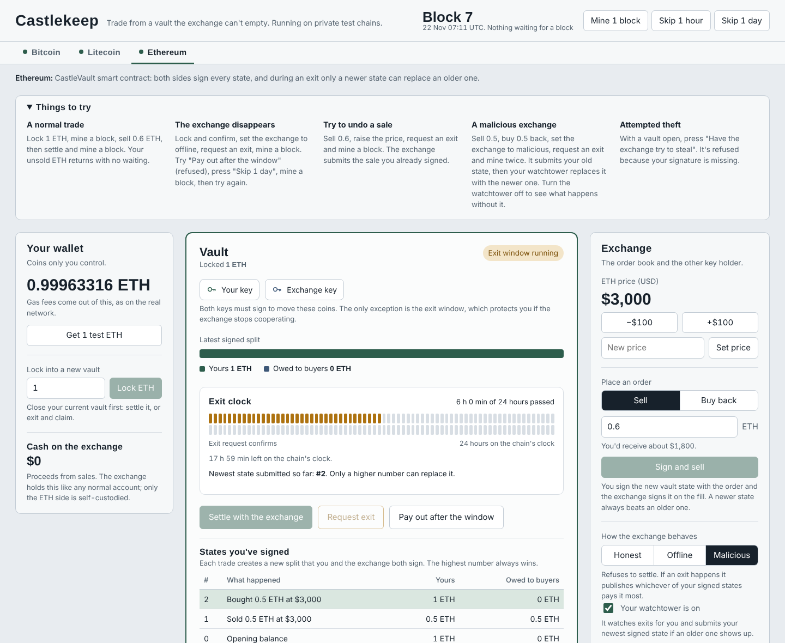

# Castlekeep console

A clickable version of Castlekeep for **Bitcoin, Litecoin and Ethereum**. It starts a
private test chain for each coin on your computer and opens a web page where you can lock
coins into a vault, trade, settle, request an exit, move the chain forward, and switch the
exchange between honest, offline and malicious.

Every button creates real transactions, and the chain itself (a Bitcoin node, a Litecoin
node, or the Ethereum smart contract) decides whether each one is accepted or refused.



> **Test networks only.** The coins have no value, nothing leaves your computer, and the
> code hasn't been audited. Never use it with real coins.

## How each chain works

| Chain | How the vault is built | Exit window | Old-state attack |
| --- | --- | --- | --- |
| **Bitcoin** | Taproot 2-of-2 script, pre-signed exit request, `CHECKSEQUENCEVERIFY` timelock | 144 blocks (about 24 hours) | **Penalty, both ways:** whoever publishes a state gets their own share locked for 6 blocks. Once a state is replaced, each side holds the other's revocation secret for it, so publishing an old state lets the other side take the cheater's share |
| **Litecoin** | The same Taproot scripts as Bitcoin | 576 blocks (blocks are 2.5 minutes, so also about 24 hours) | Same as Bitcoin, with a 24-block lock on the exchange's share |
| **Ethereum** | `CastleVault` smart contract (`contract/CastleVault.sol`). Both sides sign every state. The exchange can lock its own ETH so you can buy from it. | 24 hours on the chain's clock | **Closed:** during an exit only a state with a higher number can replace an older one, and your watchtower submits the newest |

### One account, and swapping coins

All three chains belong to **one test account**. The bar at the top of every tab shows
your BTC, LTC and ETH (wallet plus your share of each vault), one cash balance, and the
total in test dollars. Cash from selling one coin can be spent on another, and **Add
$10,000 test cash** works on every tab.

The **Swap into another coin** box sells some of this tab's coin and buys another coin with
the money, in one order and at the prices shown. No cash is used. Behind the scenes it is
two signed vault states, one on each chain:

1. The exchange signs the new state for the coin you buy.
2. Only then do you sign the sale of the coin you sell.

So you never give up one coin without already holding the other. It is not one blockchain
transaction (the chains can't see each other), and it is not a hash-locked "atomic swap".
Each vault is protected by its own chain's rules, exactly as for a normal trade.

What you can swap into follows the buying rules below: any coin you sold from that vault,
plus whatever buying capacity the exchange has locked there.

### Buying new coins (all chains)

Without help you can only buy back what you sold, because the vault only holds your coins.
On every chain you can ask the exchange to **lock its own coins in your vault** ("buying
capacity"), for a 0.2% fee taken from your share. You can then buy up to that amount with
your cash, or with a swap from another coin, and the coins you buy are in the vault from
the start.

- **Ethereum:** the exchange sends ETH to the contract (`fund`), once per vault.
- **Bitcoin and Litecoin:** you and the exchange both sign one transaction (a "splice")
  that spends the vault plus some of the exchange's coins into a bigger vault with the same
  scripts. The exit request and the pay-back are signed again, so the old ones (and every
  older state) stop working. The exchange can add more later with another splice. Its test
  wallet starts with 20 coins.

If an exit happens and nobody publishes a state, each side simply gets back what it put
in. Your watchtower publishes your latest state during the exit window, so the coins you
bought still count. With the watchtower off, they go back to the exchange.

## Set up (Windows, Command Prompt)

You need [Go](https://go.dev/dl/) 1.21 or newer. Each chain needs its own test node; any
chain you skip shows setup instructions in its tab, and the others still work.

**Bitcoin**
```
go install github.com/btcsuite/btcd@v0.24.2
```

**Litecoin**
```
go install github.com/ltcsuite/ltcd@v0.23.6
```

**Ethereum: option A, Hardhat (tested)**

Install [Node.js](https://nodejs.org) (the LTS version). Then, in a new folder:
```
npm init -y
npm install hardhat@2
echo module.exports = {}; > hardhat.config.js
npx hardhat node
```
Leave that window open: it's your Ethereum test node.

**Ethereum: option B, Anvil**

Anvil is part of Foundry. Download the Windows release from Foundry's GitHub releases
page, unzip it, and put `anvil.exe` in `%USERPROFILE%\.foundry\bin`. Castlekeep starts it
automatically. This path uses the same calls as Hardhat but hasn't been tested yet.

## Run it

Download the repository (**Code → Download ZIP**), unzip it, and open Command Prompt in the
`console` folder:

```
go mod tidy
go run .
```

If you're using Hardhat for Ethereum, start Castlekeep with:

```
go run . -eth-rpc http://127.0.0.1:8545
```

Your browser opens at `http://127.0.0.1:8080`. Each chain mines its first blocks or
deploys its contract while its tab shows a progress screen; this takes about a minute.
Keep Command Prompt open while you use the console, and press **Ctrl+C** to stop. Each run
starts fresh.

**Options**

| Flag | Use |
| --- | --- |
| `-eth-rpc URL` | Use an Ethereum dev node that's already running (Hardhat or Anvil) |
| `-btcd`, `-ltcd`, `-anvil` | Point to a node program that isn't in its default folder |
| `-port 9000` | Use a different port if 8080 is taken |
| `-no-browser` | Don't open the browser automatically |

## The screen

| Area | What it does |
| --- | --- |
| **Account bar** | Every coin you hold, the shared cash balance and the total value, on every tab. |
| **Chain tabs** | Switch between Bitcoin, Litecoin and Ethereum. A green dot means ready. |
| **Top-right buttons** | Move the chain forward. On Bitcoin and Litecoin these mine blocks; on Ethereum they mine one block or skip the clock ahead an hour or a day. |
| **Your wallet** | Test coins only you control. Get more from the faucet, or lock some into a vault. On Ethereum, gas fees come out of this. |
| **Vault** | The latest signed split, the exit clock, and the Settle, Request exit and Claim (or Pay out) buttons. On Ethereum it also shows the newest state submitted during an exit. |
| **Exchange** | Set the price, sell or buy, swap into another coin, choose how the exchange behaves, and switch your watchtower on or off. |
| **Activity and Transaction inspector** | Everything that happened, and the exact rule that accepted or refused each transaction. |

## Things to try

Each tab's "Things to try" box has the steps for that chain. The best comparison:

1. **Bitcoin tab:** sell 0.5, buy 0.5 back, set the exchange to malicious, request an exit,
   mine twice. The exchange publishes your *older* state, and your watchtower uses that
   state's revocation secret to take the exchange's share (a "penalty sweep"). Mine once
   more: you get the whole vault back. With the watchtower off, the exchange keeps its share.
2. **Ethereum tab:** do the same, then mine twice. The exchange submits the old state, your
   watchtower submits the newer one, and after **Skip 1 day** and **Pay out after the
   window** you get the whole vault back.
3. **Ethereum tab again with the watchtower switched off:** the old state stands. That's
   why someone must watch on your behalf during an exit.

**Swapping:** open a vault on Bitcoin (lock 1 BTC, mine a block). On the Ethereum tab, lock
1 ETH, mine a block, ask the exchange to lock 1 ETH and mine again. Back on the Bitcoin tab,
swap 0.04 BTC into ETH. Both vaults get a new state, and the account bar shows about
0.87 more ETH and 0.04 less BTC.

**Buying new ETH:** on the Ethereum tab, lock 1 ETH and mine a block. In the vault, ask
the exchange to lock 1 ETH and mine a block. Click **Add $10,000 test cash**, choose
**Buy**, buy 0.8 ETH, then settle and mine. Your wallet gets about 1.8 ETH back.

## Files

| File | Purpose |
| --- | --- |
| `main.go` | Starts the chains and the web server |
| `engine.go` | Types shared by every chain |
| `account.go` | The shared test account (one cash balance) and coin-to-coin swaps |
| `utxo.go`, `utxo_vault.go` | Bitcoin and Litecoin engine: Taproot scripts and transactions |
| `eth.go` | Ethereum engine: JSON-RPC, Keccak, signatures and contract calls |
| `contract/CastleVault.sol` | The Ethereum smart contract (`.bin` is the compiled bytecode) |
| `web/index.html` | The interface |

## Known limits

- **Claim alone on Bitcoin and Litecoin pays back deposits.** Without buying capacity only
  you deposit, so you get the whole vault. With it, the exchange gets its deposit back too,
  and your watchtower publishes your latest state if it pays you more.
- **Revocation on Bitcoin and Litecoin only works if someone is watching.** Your watchtower
  must sweep an old state within 6 blocks (BTC) or 24 blocks (LTC). Ethereum uses state numbers.
- **On Ethereum the exchange can lock buying capacity once per vault.** The contract allows
  one deposit; Bitcoin and Litecoin allow more with further splices.
- **The cash side is custodial**, as on any exchange. One cash balance is shared by all coins.
- **Swaps are two signed states, not one transaction.** They are only as safe as the two
  vaults they touch, and there is no hash-locked atomic swap.
- **Flat fees on Bitcoin and Litecoin**, and no fee bumping.
- **Nothing is saved.** Restarting starts new chains.
- **Solana is a design only**: see `../solana`.
